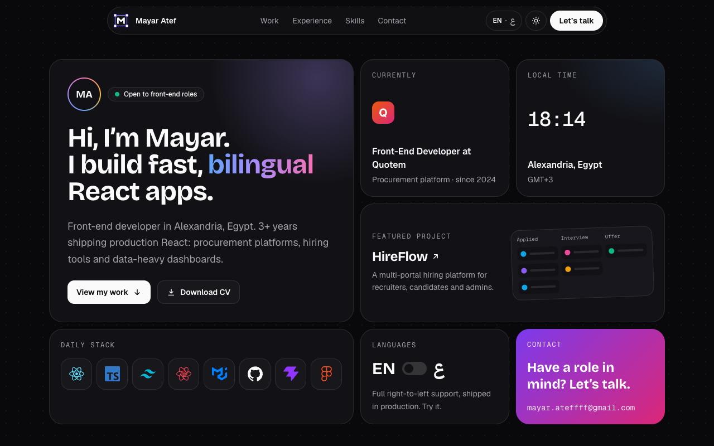
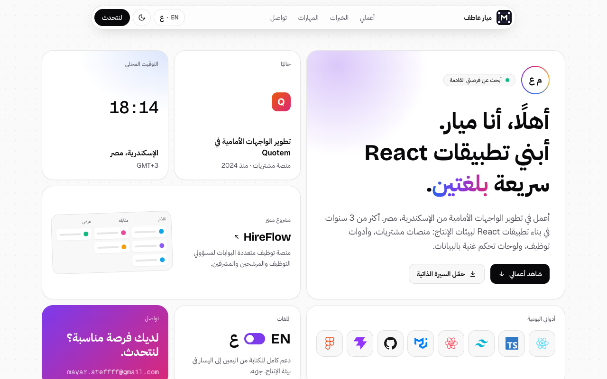
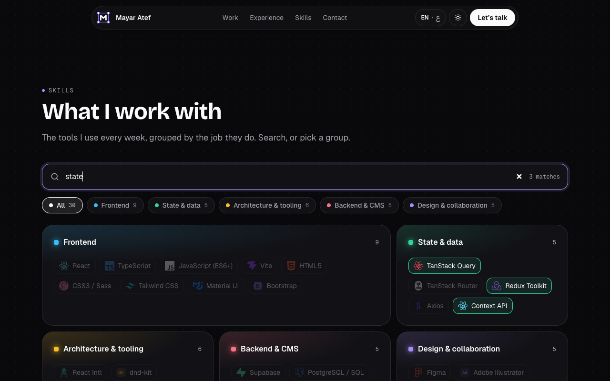

# Mayar Atef: portfolio

My personal site: a front-end developer in Alexandria, Egypt, building fast, bilingual React apps. Built with React 19, TypeScript and Tailwind CSS, in English and Arabic (full RTL), light and dark.







## What's on the page

- **A bento hero.** One screen that answers what a recruiter wants to know: who I am, where I work now, my local time in Alexandria, my featured project, my daily stack, and how to reach me. The languages card is the real language switch.
- **Selected work.** HireFlow (side project, with a live demo and source) and Quotem (day job, private, shown as a redrawn screen with made-up data).
- **Experience** as cards; on wide screens, hovering one role dims the rest.
- **Skills** grouped by the job they do, each group in its own color, with real logos, filter chips and a search that also matches keywords ("rtl" finds React Intl, "forms" finds React Hook Form). Press <kbd>/</kbd> to jump to it.
- **Contact** with the email (and a copy button), LinkedIn, GitHub and the CV.

## Things worth reading in the code

| What                                                                                                                | Where                                                                                                                                      |
| ------------------------------------------------------------------------------------------------------------------- | ------------------------------------------------------------------------------------------------------------------------------------------ |
| The bento grid as named `grid-template-areas`, which mirror automatically in Arabic                                 | [`src/index.css`](src/index.css), [`src/sections/Hero.tsx`](src/sections/Hero.tsx)                                                         |
| Language switch as a view transition: the new page is revealed in the direction it reads                            | [`src/lib/viewTransition.ts`](src/lib/viewTransition.ts), [`src/i18n/LocaleProvider.tsx`](src/i18n/LocaleProvider.tsx)                     |
| Brand logos from Simple Icons, with near-black and near-white logos switching to the text color where they'd vanish | [`src/components/BrandIcon.tsx`](src/components/BrandIcon.tsx), [`src/data/skills.ts`](src/data/skills.ts)                                 |
| Skills search and filters, with a live result count for screen readers                                              | [`src/sections/Skills.tsx`](src/sections/Skills.tsx)                                                                                       |
| Project previews drawn in HTML and CSS, not screenshots, so they follow the theme and mirror in Arabic              | [`src/components/BoardPreview.tsx`](src/components/BoardPreview.tsx), [`src/components/QuotePreview.tsx`](src/components/QuotePreview.tsx) |
| A small Vite plugin that preloads the hero fonts, so they download alongside the JavaScript                         | [`vite.config.ts`](vite.config.ts)                                                                                                         |
| Arabic font loaded per weight, so its `unicode-range` keeps it from downloading on English pages                    | [`src/main.tsx`](src/main.tsx)                                                                                                             |
| Theme as a class on `<html>` plus an inline script, so there's no flash of the wrong theme                          | [`src/components/ThemeToggle.tsx`](src/components/ThemeToggle.tsx), [`index.html`](index.html)                                             |
| Typed translations: a missing Arabic string or a mistyped message id fails the build                                | [`src/i18n/`](src/i18n/)                                                                                                                   |

## Numbers (production build, served with gzip, Lighthouse 12)

- Lighthouse: **100 / 100 / 100 / 100** on desktop; **93 / 100 / 100 / 100** on mobile, in both light and dark themes.
- No accessibility issues from axe in English and Arabic, light and dark.
- Initial JavaScript is about **116 KB gzip**.
- No UI library and no animation library.

## Design

| Area   | Choice                                                                                                          |
| ------ | --------------------------------------------------------------------------------------------------------------- |
| Colors | Zinc neutrals, one violet accent, and a blue-violet-pink gradient for a few highlights; a color per skill group |
| Type   | Bricolage Grotesque for headings, Geist for text, Geist Mono for labels, IBM Plex Sans Arabic for Arabic        |
| Mark   | An "M" selected like a layer in a design tool, resize handles and all (also the favicon)                        |

## Tech stack

| Area    | Tools                                                          |
| ------- | -------------------------------------------------------------- |
| Core    | React 19, TypeScript, Vite                                     |
| Styling | Tailwind CSS with CSS-variable color tokens, self-hosted fonts |
| i18n    | react-intl (English / Arabic, RTL), typed message ids          |
| Icons   | Simple Icons (brand logos), hand-drawn SVG for UI icons        |
| Quality | ESLint (incl. React Compiler rules), Prettier                  |

## Getting started

Requires Node 22 (see `.nvmrc`).

```bash
npm install
npm run dev        # http://localhost:3005
```

## Scripts

| Script                      | What it does                                            |
| --------------------------- | ------------------------------------------------------- |
| `npm run dev`               | Start the dev server                                    |
| `npm run build`             | Typecheck and build for production                      |
| `npm run preview`           | Serve the production build                              |
| `npm run lint` / `lint:fix` | ESLint (zero warnings allowed); `lint:fix` also formats |
| `npm run typecheck`         | TypeScript without emitting                             |
| `npm run format`            | Prettier (`src/`)                                       |

## Project structure

```
src/
  sections/    Hero (bento), Work (HireFlow + Quotem), Experience, Skills, Contact
  components/  header, footer, toggles, logo mark, brand icons, project previews, icons
  data/        typed content in English and Arabic (experience, projects, skills, links)
  i18n/        messages (en.json, ar.json), locale provider
  lib/         view transitions, local time, shared styles, class-name helper
```

## Related

[HireFlow](https://github.com/MayarrAteff/hireflow) is a multi-portal hiring platform (React, TypeScript, Supabase). It's the featured side project on the site. [Live demo](https://hireflow-sigma-nine.vercel.app/)
