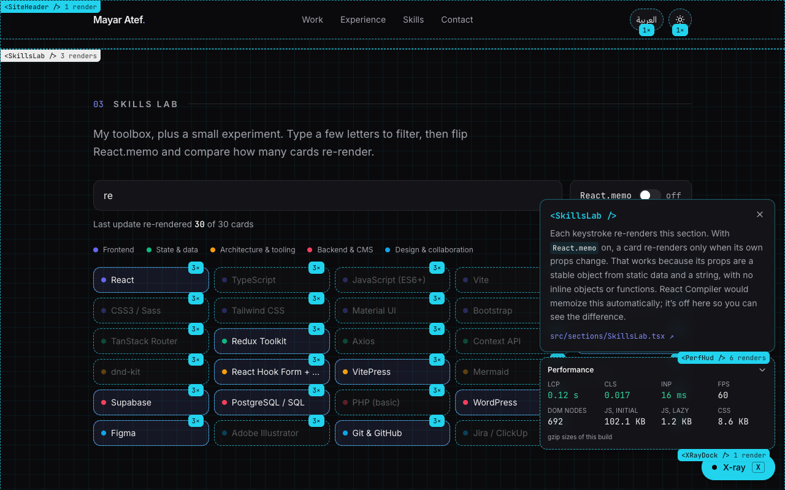

# Mayar Atef: a portfolio that explains itself

My personal site, built with React 19, TypeScript and Tailwind CSS, in English and Arabic (full RTL).

**Press `X` on the page** (or add `?xray=1` to the URL) to turn on **X-ray mode**. Every component then shows:

- a dashed outline with its name,
- a live render count that flashes when the component renders,
- a note on why it's built that way, with a link to its source file in this repo.





## Things worth reading in the code

| What                                                                                                                     | Where                                                               |
| ------------------------------------------------------------------------------------------------------------------------ | ------------------------------------------------------------------- |
| Render counter that never causes renders itself (compares `children` identity, writes to the DOM in a layout effect)     | [`src/xray/useRenderCount.ts`](src/xray/useRenderCount.ts)          |
| Two contexts, so selecting a label doesn't re-render sections that only care whether X-ray is on                          | [`src/xray/XRayProvider.tsx`](src/xray/XRayProvider.tsx)            |
| Skills Lab: a live `React.memo` on/off experiment that counts how many cards re-render per keystroke                     | [`src/sections/SkillsLab.tsx`](src/sections/SkillsLab.tsx)          |
| Performance panel loaded with `React.lazy`, build stats read with `use()`, Web Vitals through `useSyncExternalStore`     | [`src/xray/PerfHud.tsx`](src/xray/PerfHud.tsx), [`src/lib/vitals.ts`](src/lib/vitals.ts) |
| A small Vite plugin that gzips the build output and writes `build-stats.json` for the panel                                | [`build-stats.ts`](build-stats.ts)                                  |
| Theme as a class on `<html>` plus an inline script, so no flash of the wrong theme and only one component re-renders      | [`src/components/ThemeToggle.tsx`](src/components/ThemeToggle.tsx), [`index.html`](index.html) |
| Typed translations: a missing Arabic string or a mistyped message id fails the build                                     | [`src/i18n/`](src/i18n/)                                            |
| RTL through `dir` and logical utilities (`ps-4`, `start-0`); only directional icons are mirrored                          | [`src/components/icons.tsx`](src/components/icons.tsx)              |

## Numbers (production build)

- Lighthouse: **100 / 100 / 100 / 100** on desktop; **96 / 100 / 100 / 100** on mobile.
- Initial JavaScript is about **102 KB gzip**. The performance panel is a separate **~1 KB** chunk that loads only when X-ray turns on.
- No UI library and no animation library. Section reveals use `IntersectionObserver` and CSS transitions.

## Tech stack

| Area    | Tools                                                                   |
| ------- | ----------------------------------------------------------------------- |
| Core    | React 19, TypeScript, Vite                                              |
| Styling | Tailwind CSS with CSS-variable color tokens, self-hosted fonts          |
| i18n    | react-intl (English / Arabic, RTL), typed message ids                   |
| Metrics | web-vitals, a custom Vite build-stats plugin                            |
| Quality | ESLint (incl. React Compiler rules), Prettier                           |

## Getting started

Requires Node 22 (see `.nvmrc`).

```bash
npm install
npm run dev        # http://localhost:3005
```

Bundle sizes in the performance panel only appear in a production build:

```bash
npm run build && npm run preview
```

## Scripts

| Script                      | What it does                                            |
| --------------------------- | ------------------------------------------------------- |
| `npm run dev`               | Start the dev server                                    |
| `npm run build`             | Typecheck and build for production                      |
| `npm run preview`           | Serve the production build                              |
| `npm run lint` / `lint:fix` | ESLint (zero warnings allowed); `lint:fix` also formats |
| `npm run typecheck`         | TypeScript without emitting                             |
| `npm run format`            | Prettier (`src/`)                                       |

## Project structure

```
src/
  xray/        X-ray mode: provider, <Inspect> wrapper, render counter, note panel, performance panel
  sections/    Hero, FeaturedProject (HireFlow), Experience, SkillsLab, Contact
  components/  header, footer, toggles, icons, board preview, reveal-on-scroll
  data/        typed content in English and Arabic (experience, projects, skills, links)
  i18n/        messages (en.json, ar.json), locale provider, rich-text tags
  lib/         Web Vitals store, shared styles, class-name helper
build-stats.ts Vite plugin that writes build-stats.json
```

## Related

[HireFlow](https://github.com/MayarrAteff/hireflow) is a multi-portal hiring platform (React, TypeScript, Supabase). It's the featured project on the site. [Live demo](https://hireflow-sigma-nine.vercel.app/)
